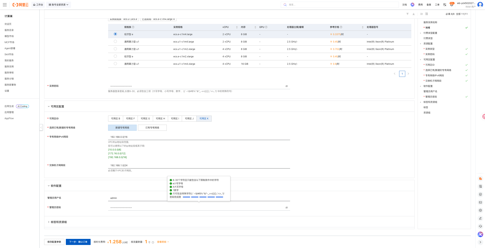
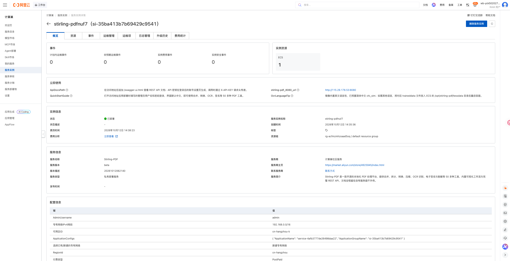
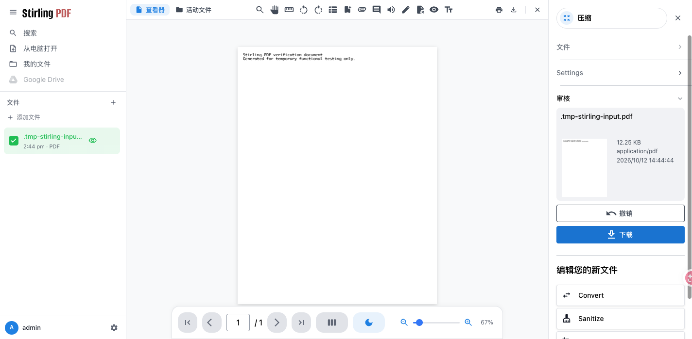

# Stirling-PDF 计算巢部署文档

## 概述

[Stirling-PDF](https://github.com/Stirling-Tools/Stirling-PDF) 是开源的自托管 PDF 处理平台，提供合并、拆分、转换、压缩、OCR、签名、脱敏和 REST API 等工具。本方案使用官方 Full 镜像，通过 Docker Compose 部署在用户自己的 ECS 中，文件处理和应用数据不需要上传到第三方 PDF 网站。

| 项目 | 说明 |
| --- | --- |
| 服务 ID | `service-4afb3777de26498daa22` |
| 部署形态 | 单台 ECS + Docker Compose |
| 应用镜像 | `stirlingtools/stirling-pdf:latest` |
| 访问端口 | 8080（Web UI 与 REST API） |
| 数据存储 | ECS `/opt/stirling-pdf` |
| 数据库 | 内嵌 H2，无需外接数据库 |
| 实测部署耗时 | 约 3 分钟 |

## 部署架构

```text
浏览器
  │ HTTP 8080
  ▼
安全组
  ▼
ECS
  └─ Docker Compose：Stirling-PDF
       ├─ /configs       → /opt/stirling-pdf/configs
       ├─ /logs          → /opt/stirling-pdf/logs
       ├─ /usr/share/tessdata → /opt/stirling-pdf/tessdata
       ├─ /pipeline      → /opt/stirling-pdf/pipeline
       └─ /customFiles   → /opt/stirling-pdf/customFiles
```

计算巢通过 ROS 创建 VPC、交换机、安全组和 ECS，并通过云助手启动应用。Stirling-PDF 使用内嵌 H2 数据库，不会额外创建 RDS。

## 部署前准备

### 账号与权限

请使用已完成实名认证的阿里云账号，并确保账号可以创建以下资源：

- 计算巢服务实例；
- ROS 资源栈；
- ECS 实例、系统盘与安全组；
- VPC 和交换机。

使用 RAM 用户部署时，应由管理员授予上述资源的创建、查询和删除权限。

### 计费说明

部署会创建一台 ECS、200 GiB ESSD 系统盘并使用公网带宽。费用以创建页实时询价和阿里云账单为准。测试场景建议选择按量付费，并在验证结束后及时删除服务实例。

## 部署步骤

### 1. 打开创建页面

访问 [Stirling-PDF 服务实例创建页](https://computenest.console.aliyun.com/service/instance/create/cn-hangzhou?type=user&ServiceId=service-4afb3777de26498daa22)。



### 2. 配置部署参数

| 参数 | 说明 | 建议 |
| --- | --- | --- |
| 服务实例名称 | 控制台中用于识别本次部署 | 保持默认或自定义 |
| 地域、可用区 | ECS 所在位置 | 选择接近使用者且有库存的地域和可用区 |
| 付费类型 | 按量付费或包年包月 | 测试使用按量付费 |
| 实例类型 | ECS 规格 | 2 vCPU / 8 GiB 起 |
| 实例密码 | ECS 登录密码 | 使用符合页面规则的强密码 |
| 专有网络 | 新建或复用 VPC | 首次部署可选择新建 |
| VPC/交换机网段 | 网络地址范围 | 无冲突时保持默认 |
| 管理员用户名 | Stirling-PDF 登录用户名 | 默认 `admin`，也可自定义 |
| 管理员密码 | Stirling-PDF 首个管理员密码 | 使用独立强密码 |

管理员凭据只在应用首次初始化、用户表为空时生效。请勿使用上游默认密码，也不要将密码写入文档或代码仓库。

填写完成并看到询价结果后，点击“下一步：确认订单”，核对资源和费用，勾选服务协议并创建实例。

### 3. 等待部署完成

进入服务实例详情页，等待状态变为“已部署”。本次实测从创建到部署完成约 3 分钟。



“立即使用”区域会显示：

- `stirling-pdf_8080_url`：应用访问地址；
- `QuickStartGuide`：登录与使用说明；
- `ApiDocsPath`：REST API 文档与 API Key 使用说明；
- `OcrLanguageTip`：OCR 语言包说明。

### 4. 登录并使用

打开 `stirling-pdf_8080_url`，未认证访问会跳转到 `/login`。使用部署时填写的管理员用户名和密码登录，即可从工具面板选择 PDF 工具。

发布前实测已完成以下验证：

1. 上传一份单页 PDF；
2. 选择“压缩”工具并执行；
3. 结果页正常显示输出文件；
4. 下载结果为有效 PDF 文件。



REST API 文档位于 `/swagger-ui.html`。API Key 需登录后在账号设置中生成，并通过 `X-API-KEY` 请求头传递。

## 数据与安全

- 配置和 H2 数据库保存在 `/opt/stirling-pdf/configs`，日志、OCR 语言包、工作流和自定义文件也持久化在 `/opt/stirling-pdf` 下。
- 文档在用户自己的 ECS 中处理；删除 ECS 或服务实例前请先备份需要保留的数据。
- 应用启用了登录认证，但默认访问链路为公网 HTTP 8080。生产环境建议限制安全组来源，并配置 HTTPS 反向代理。
- 镜像内置英文 OCR 语言包，并预置简体中文 `chi_sim`。其他语言可将对应 `traineddata` 文件放入 `/opt/stirling-pdf/tessdata` 后重启容器。
- SSO/OAuth2 需要 HTTPS，请在 ECS 前配置 Nginx、Traefik 或 Caddy 做 TLS 终止。

## 资源释放

不再使用时，在计算巢服务实例详情页执行“删除”。删除完成后建议继续确认：

1. 服务实例已不存在；
2. ROS 资源栈状态为 `DELETE_COMPLETE`；
3. ECS、VPC、交换机和安全组均无残留；
4. 账单中不再产生相关按量资源费用。

删除服务实例会同时删除 ECS 及其本地数据，请提前导出或备份重要文件和配置。

## 官方链接

- [Stirling-PDF 官方仓库](https://github.com/Stirling-Tools/Stirling-PDF)
- [Stirling-PDF 官方文档](https://docs.stirlingpdf.com/)
- [Stirling-PDF Docker 安装文档](https://docs.stirlingpdf.com/Installation/Docker/)
- [阿里云计算巢文档](https://help.aliyun.com/zh/compute-nest/)
